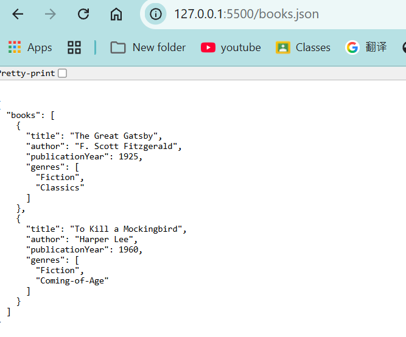
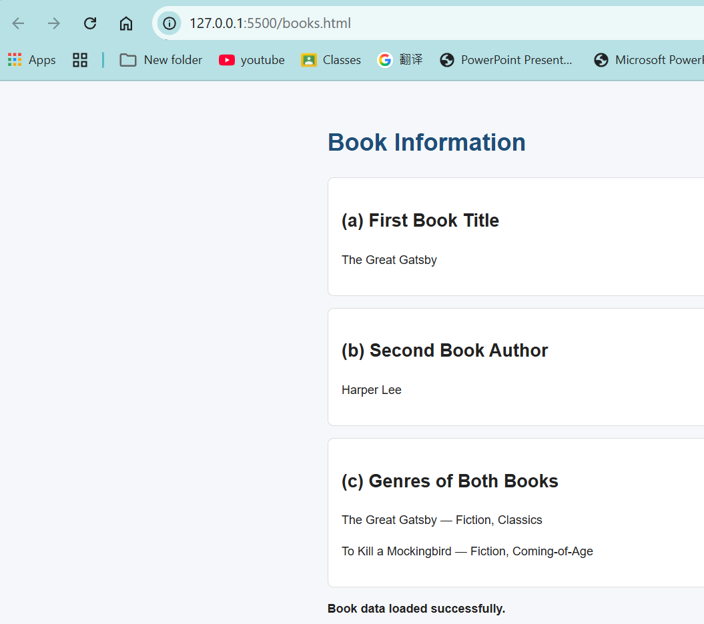
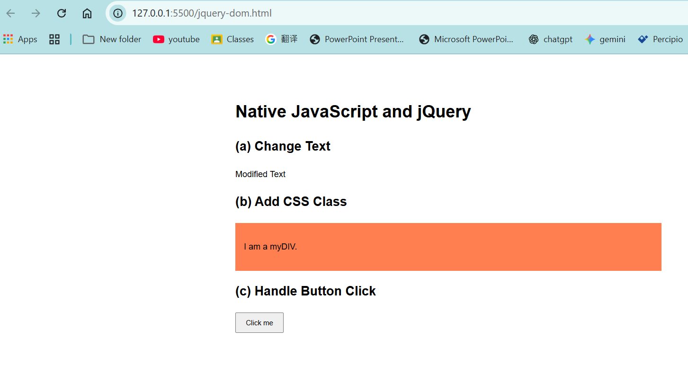
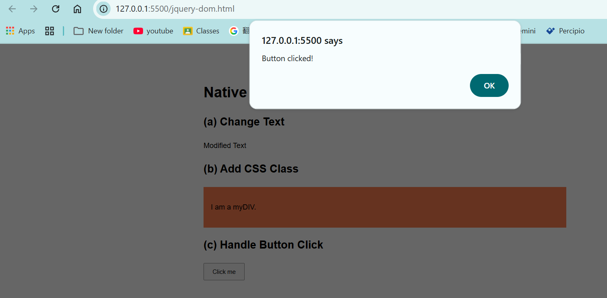

# BIC21203 Lab 4b: JSON and jQuery

## Introduction

This lab demonstrates JSON data structures, retrieving
JSON data using the Fetch API, and manipulating webpage
elements using jQuery.

## Files

- `books.json`: Contains two book objects.
- `books.html`: Retrieves and displays data using fetch().
- `jquery-dom.html`: Demonstrates jQuery DOM manipulation
  and click event handling.

## Requirements

- Visual Studio Code or another code editor.
- A modern web browser.
- Live Server or another local development server.
- Internet access to load the jQuery CDN.

## How to Run

1. Open the project folder in Visual Studio Code.
2. Open `books.html`.
3. Right-click and select Open with Live Server.
4. Check the title, author, and genre results.
5. Open `jquery-dom.html` using Live Server.
6. Check the modified text and coral background.
7. Click the button to test the alert.

Keep `books.json` in the same folder as `books.html`.

## Screenshots

### Question 1: JSON Dataset

### Question 2: Fetch API Output

### Question 3: jQuery DOM Manipulation

### Question 3: Button Click Alert

## Conclusion

This lab demonstrates how to structure JSON data,
retrieve and display it with the Fetch API, handle
errors, and use jQuery to update DOM elements and
respond to click events.
